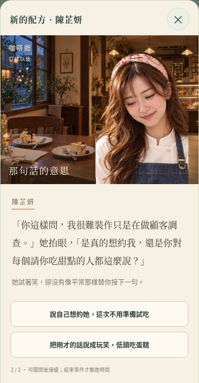

# PR #12 舊事件與新版場景整合

2026-10-29（Asia/Taipei）。最新 `origin/main` 為 `a7197fe`，已包含 #13 和 #14。將它以一般 merge 整合進既有 `fix/legacy-event-dialogue`；不 rebase、不 force push、不建立另一個 PR、不合併 PR。

## 衝突處理與保留內容

| 檔案 | 整合方式 |
| --- | --- |
| js/life.js | 同時載入事件內容／精確官方辨識及場景模組；先保留舊 pending 情境投影，再處理新版主線後續回應。保留原結果、scene／實際回應紀錄、節拍重設及一次結算 |
| index.html | 舊快照 → events、scene-data → scenes，全部在唯一一份 life.js／core.js／app.js 前載入。life.js 使用新 `legacy-scenes1` 鍵；保留兩邊其他檔案的發行鍵 |
| README.md、TESTING.md | 保留雙方功能文件並新增此次整合結果，歷史驗證數量明確標記 |
| js/app.js、js/scenes.js、js/scene-data.js、CSS、所有人物／場景素材 | 完整保留最新 main，沒有重新設計演出或覆蓋成舊 UI |
| js/events.js、js/legacy-events-v1.js、編輯器 | 保留原 PR #12 的情境選項、精確遷移、玩家內容保護與編輯器修正 |
| tests/story-browser.cjs | 自動合併後逐項核對，保留主線閱讀節拍及《招牌草稿》舊存檔回歸 |

仍停用官方 life1、life2、key、v03-intimacy、v03-choice 的預設自動觸發；保留完成紀錄、作者前置依賴例外，以及重寫的 v03-together。完整範圍見 [舊事件盤點](../../LEGACY_EVENTS.md)。

新版主線保持原 21 段 ID、時地、前置、選項與結果，三人的服裝、表情、動作及分支記憶保留。一般聊天、AI Mock、角色圖鑑、工作家庭、地圖探索與存檔也均回歸驗證。

## 自動化結果

- `node --test tests/*.test.cjs`：**110 項通過，0 失敗／跳過**。原 PR #12 的 95 項，加上 main 的 11 項場景測試及本次 4 項整合測試。
- 新 `legacy-scenes-integration.test.cjs`：21 段透過原行程／可遇見條件進入官方場景；舊 main 存檔遷移保持關係／紀錄／工作家庭；場景 pending 的節拍／分支軌跡可重載；舊 pending 及玩家編輯事件保持原圖；主線空檔不觸發舊線。
- 新 `legacy-scenes-browser.cjs`：**12 次真實主線入口 + 12 次舊 pending 續接**（三人 × 320／375／390／430px），並驗證三人主線空檔皆為一般聊天。使用 `/city-encounters/` 子路徑，實際載入 HTML 的雙模組；驗證載入順序、新 life.js 鍵、場景／表情、圖資解碼、無橫向溢出、節拍／終端刷新、原關係／分支紀錄保留，以及一次時段／感情結算。
- 原 `scene-rollout-browser.cjs`：21 × 四寬度共 **84 次流程**，含兩套服裝、圖集座標、三角色缺圖回退及全圖失敗；Node 場景測試仍涵蓋 **92 節點、62 條結果路徑**。
- 原 `story-browser.cjs`、`recipe-scene-browser.cjs` 全通過；保留《招牌草稿》情境選項、舊主線終端遷移、三人的多輪／場景，以及芷妍味覺記憶、實際深入交流入口、重試及單次結算。
- `browser-smoke.cjs` **17 組**、`portraits-browser.cjs` **5 組**、`ai-browser.cjs` Mock **2 組**、`town-map-browser.cjs` **7 組**、`town-alignment-browser.cjs` **6 組**全部通過。
- 共 **九支 Chromium 瀏覽器腳本**通過；所有 js、worker/index.mjs、測試檔案語法及 git diff --check 通過。靜態前端無套件建置步驟，Worker 行為由現有自動化測試覆蓋，未部署／呼叫真實 AI。

重現（需 playwright-core 及本機 Chromium）：

```sh
node --test tests/*.test.cjs
CHROMIUM_PATH=/usr/bin/chromium node tests/legacy-scenes-browser.cjs
CHROMIUM_PATH=/usr/bin/chromium node tests/scene-rollout-browser.cjs
CHROMIUM_PATH=/usr/bin/chromium node tests/recipe-scene-browser.cjs
CHROMIUM_PATH=/usr/bin/chromium node tests/story-browser.cjs
CHROMIUM_PATH=/usr/bin/chromium node tests/browser-smoke.cjs
CHROMIUM_PATH=/usr/bin/chromium node tests/portraits-browser.cjs
CHROMIUM_PATH=/usr/bin/chromium node tests/ai-browser.cjs
CHROMIUM_PATH=/usr/bin/chromium node tests/town-map-browser.cjs
CHROMIUM_PATH=/usr/bin/chromium node tests/town-alignment-browser.cjs
```

肖像與 AI Mock 測試使用同一個固定 port，須依上列順序執行；其他測試採動態 port 或各自固定 port。測試輸出在 `work/pr12-integration/`；新的四寬度 24 張手機截圖位於該目錄的 screenshots/。

## 當次整合截圖

390×844 CSS viewport，實際遊戲對話面板截圖。新版主線經「深入交流」進入；舊事件則以已儲存 pending 模擬續接，沒有新增玩家可用跳關入口。

| 角色 | 新主線場景／分支表情 | 已保存舊事件的情境回答 |
| --- | --- | --- |
| 若晴 |  |  |
| 以安 |  |  |
| 芷妍 |  |  |

原 21 段演出的四種寬度截圖及服裝表仍見 [核心主線演出](../core-scenes/README.md)。

## 剩餘限制

WebKit 二進位未安裝，沒有實體 iPhone 裝置，因此本次未實測 WebKit／真機 Safari；Chromium 手機模擬不能代替它們。未呼叫真實 AI、未部署 GitHub Pages／Worker。沒有已知自動化失敗或未解衝突；安全合併的評估僅涵蓋本地自動化、靜態檢查及遠端可合併狀態，真機觀感仍需人工驗收。
