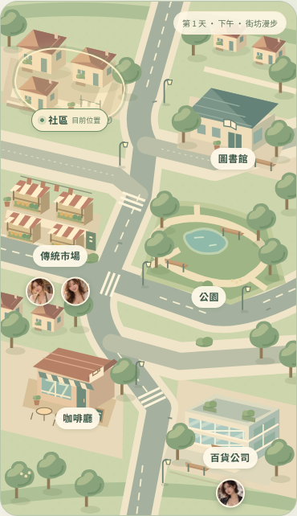
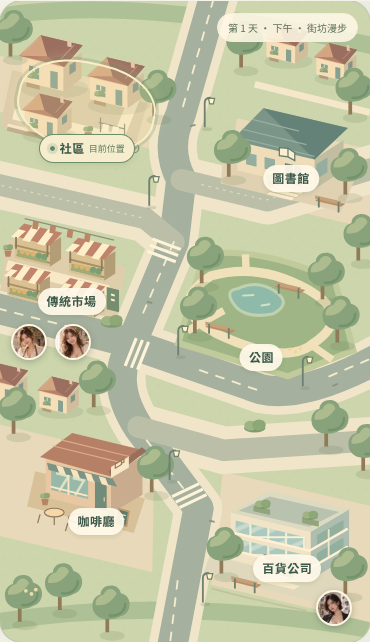
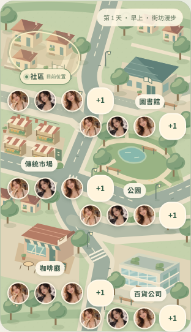
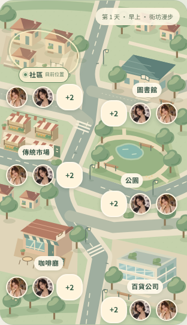
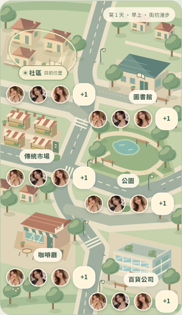
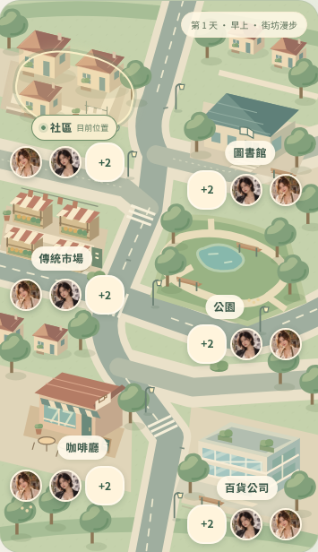
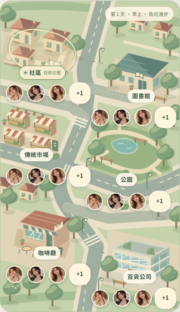
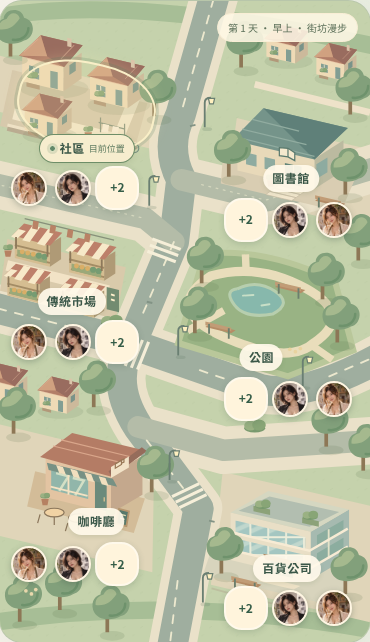
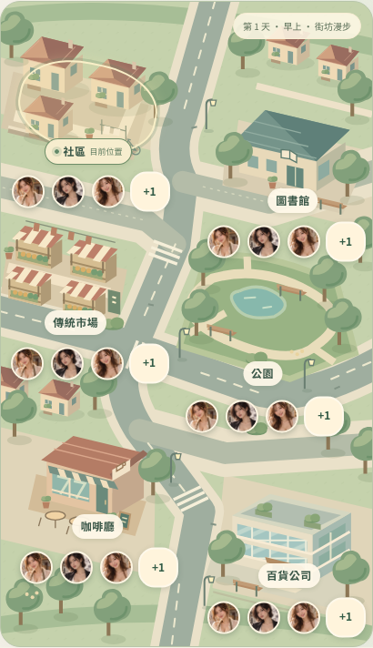
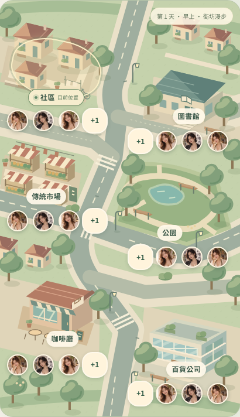

# 小鎮地圖定位修正：手機截圖比較

基準：main `5995783`，PR #9 合併後。日期：2026-10-29（Asia/Taipei）。所有圖片由同一套 Chromium 手機觸控測試擷取，CSS viewport 高度 844px，寬度如下。既有 `assets/town-map.svg` 與三張正式人物肖像均未修改。

## 原遊戲行程，390px

相同初始遊戲狀態、第 1 天下午、目前位於社區。人物位置仍由原工作與生活排程計算：市場兩人、百貨一人。此組沒有新增或改寫人物行程。

| 修正前 | 修正後 |
| --- | --- |
|  |  |

[修正前完整手機 viewport](before-game-390-viewport.png) · [修正後完整手機 viewport](after-game-390-viewport.png)

## 六處同時擁擠的壓力測試

為了同時檢查六處標記，每個地點各放置四位不同 ID 的測試人物，重用既有肖像。這些人物只存在瀏覽器測試輸入，沒有加入正式遊戲資料或排程。修正前後使用同一份測試狀態，均為第 1 天早上、目前位於社區。

完整地圖截圖暫時隱去固定導覽列，以免長圖被固定圖層蓋住；實際手機 viewport 截圖保留導覽列。互動測試另外將六處建築與標籤捲至可見區，確認都能在導覽列上方點選。

| CSS viewport | 修正前 | 修正後 |
| --- | --- | --- |
| 320px |  |  |
| 375px |  |  |
| 390px |  |  |
| 430px |  |  |

原版 320px 有 5 組頭像列與建築點擊區／其他頭像列的交疊，375px、390px 各 1 組，430px 為 0。修正後四種寬度皆為 0，並測過每處 0／1／2／3／8 人及不中斷遊戲的連續縮放，包含 414px 和容量切換邊界。

多人時依兩側街區可用寬度容納 44×44px 觸控區：320／375／390px 的擁擠地點顯示兩張頭像及 `+N`，430px 可容納三張及 `+N`。只有三人時仍顯示三張。`+N` 及地點面板可查看完整名單。座標錨點不會因人數或寬度被 clamp 推走。

## 同一人物的頭像裁切

三位正式角色，同為 36 CSS px 圓形頭像。圖片維持原始比例，置頂裁切至肩部，移除第二層 `transform: scale(2)` 放大；頭髮、眼睛、下巴均可辨識。

| 修正前 | 修正後 |
| --- | --- |
|  |  |

## 重現與限制

```sh
# 保存同一份 main 基準；勿直接用移動後的 main 取代歷史比較版本。
mkdir -p work/alignment-before
git archive 5995783 | tar -x -C work/alignment-before
TOWN_BASELINE_DIR=work/alignment-before node tests/town-alignment-browser.cjs
node tests/town-alignment-browser.cjs
```

測試在 `/city-encounters/` 子路徑供應真實遊戲，檢查背景與疊加層尺寸、六個 SVG 地標的觸控命中、標籤與頭像錨點、交疊及溢出。也驗證延遲載入、停用 CSS aspect-ratio、地圖 404、損壞肖像及舊的未加版本資源快取。

環境沒有 WebKit 執行檔；嘗試安裝時下載主機回傳 `403 Domain forbidden`。因此 WebKit 與實體 iPhone Safari **未實測**。已提供 `BROWSER=webkit node tests/town-alignment-browser.cjs`，可在安裝相容 Playwright WebKit 的環境執行。

正式 `qaswedcx.github.io` 網站也被環境代理以 403 擋住，無法核實其目前快取或正式部署的回應；本次驗證的是本機相同子路徑與資源版本鍵，沒有宣稱正式站或真機已通過。
