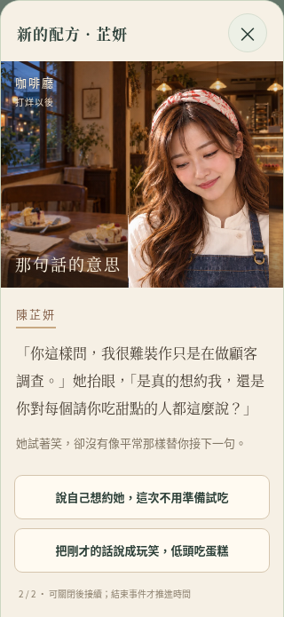

# 《新的配方》品質樣本

本次只完成陳芷妍第六段主線 story6「新的配方」，直接由城市探索 → 咖啡廳 → 深入交流進入；沒有新增展示頁、跳關入口或另一套事件引擎。

## 完成內容

- 一張打烊後的咖啡廳內景，含窗外暮色、暖燈、烤箱、兩份甜點與叉子。
- 以既有芷妍肖像為參考的新工作服頭肩差分：專注、微笑、含蓄低頭，共用同一張透明圖集。工作服採高領上衣與完整圍裙，原標準肖像仍保留。
- 每節分成可自行閱讀的演出節拍：動作、台詞、沉默及表情。淡入 240ms，支援 reduced-motion，不強制倒數或自動選擇。
- 第二段的味覺選擇影響本次試吃台詞；認真邀約、退回玩笑、討論配方仍使用原分支與原結果。猶豫後重試會承接前次氣氛，成功後 story7 有對應的後續提及。
- 操作按鈕與角色台詞分開。閱讀節拍不推時間、不加關係；最後「結束對話」才沿原規則結算一次。

## 手機畫面

同一個含蓄低頭的追問節點，實際 CSS viewport 高度 844px，無水平溢出，選項可觸控及捲動。

| 320px | 375px |
| --- | --- |
|  |  |

| 390px | 430px |
| --- | --- |
|  |  |

## 狀態與相容

`js/scenes.js` 是呈現資料與唯讀投影，沿用 story6 的五個原節點。只有人物、事件 ID 與完整官方事件內容都符合時才套用樣本；玩家改過的事件及舊版未完成圖維持原呈現，不會被節拍索引覆蓋。

目前節拍存在既有 pending 的可選 `sceneBeat`，重新整理／關閉後能接續。選擇分支時重設節拍。結算紀錄增加可選 scene 標記並保存實際演出的回應，讓後續對話能承接；不改存檔鍵或 schema，不刪舊存檔，不重播已完成事件。

原 ID、前置、時地、熟悉／信任門檻、選項索引、結果、關係變化與移動／時間規則保留。不是自動生成遊戲約定；台詞中的下次邀約不會擅自新增行程。

圖片只從本機 assets 載入，內景約 201KiB，透明差分約 476KiB；由 imagegen 依原肖像製作，再轉存 WebP，未取代原人物圖資。差分沿用辨識特徵，但屬 AI 生成的新工作服素材，仍需人工美術確認後決定是否作為其他事件的標準。

## 回退與驗證

- 差分缺失回退原標準肖像；內景缺失使用暖色背景，仍能閱讀、選擇及結算。
- `node --test tests/*.test.cjs`：94 項通過，包括投影不改狀態、舊／自訂事件隔離、味覺與猶豫記憶、節拍保存、原分支結果、一次結算與後續回應。
- `node tests/recipe-scene-browser.cjs`：從實際地點入口啟動，驗證四種手機寬度、差分、味覺變化、刷新、單次時間／獎勵、缺圖回退、自訂故事及快速連點。
- 原 story-browser、browser-smoke（17 組）、portraits-browser（5 組）、AI Mock（2 組）、town-map-browser（7 組）、town-alignment-browser（6 組）通過。地圖測試補上等待 resize observer 完成容量更新，避免在 DOM 替換途中量測到空的熱區。
- 全部遊戲 JS 語法與 git diff --check 通過。靜態專案沒有套件建置步驟。

實體 iPhone Safari／WebKit 尚未實測，未使用真實 AI 聊天、未部署正式站。其餘人物與事件尚未擴展差分，本 PR 是供後續擴展的單段品質樣本。
